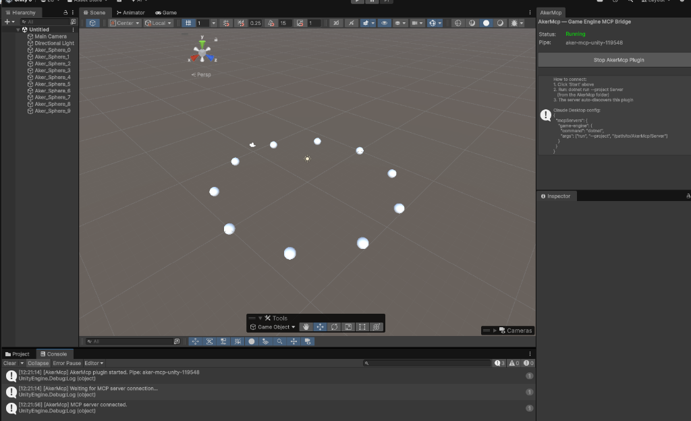
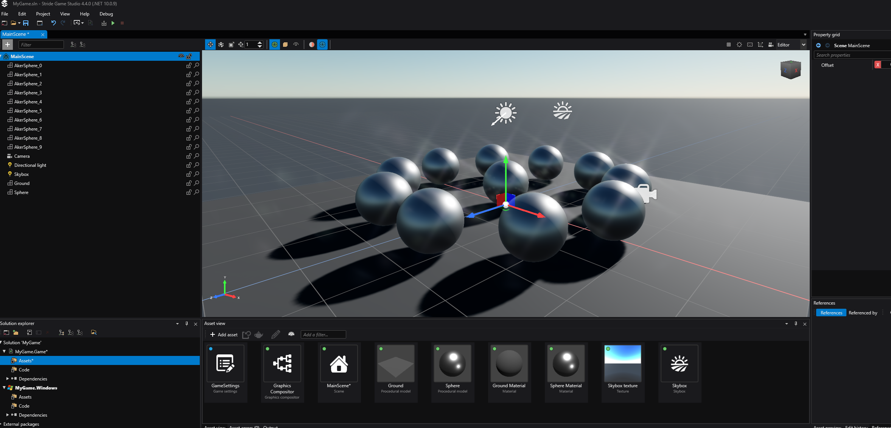
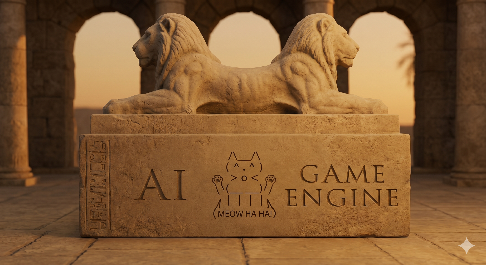

# AkerMCP — Live MCP Server for Unity, Godot 4 & Stride

**Give Claude Code, Cursor, Copilot, Windsurf or Antigravity eyes and hands inside your running game editor:** read and change the live scene, run C# on the editor's main thread, look at the result, play the game and check what happened.

<!--
  VIDEO SLOT: drag the 30-second MP4 into a GitHub issue or PR to get a hosted URL,
  then paste that URL on its own line here (GitHub renders it as an inline video).
-->

  

AkerMCP is an MCP server that runs on your machine, next to the editor, and lets an AI client (Claude Code, Cursor, Copilot, Antigravity, any stdio MCP client) work inside a running C# game editor: read the scene, change it (objects created or deleted are steps in the editor's undo history), run C# on the editor's main thread, take a screenshot, enter play mode and check what happened. One server and one tool set for three engines, Unity, Godot and Stride Game Studio, each behind a small adapter over the same core.

## Why AkerMCP?

- **Real debugging, not just spawning cubes.** `execute` compiles and runs any C# against the live editor, with `using` lines and type declarations hoisted, so a helper class or a MonoBehaviour is written and attached in one call. `take_screenshot` shows the result with the editor's gizmos. `playtest` drives input and evaluates C# assertions at exact moments on the timeline, all inside one call, which is the only way to catch a transient as short as the top of a jump arc.
- **Generic tools, not one per operation.** Forty-two tools built on reflection and Roslyn instead of a hand-written tool per engine API, layered so the model pays only for what it uses: `core` (14 tools, about 2,300 tokens of definitions), `standard` (27, the default), `full` (42, with sprite and audio authoring, `playtest`, builds and `ui_action`).
- **One tool set, three engines.** The other MCP servers for game engines are tied to one engine each: unity-mcp and Unity-MCP to Unity, godot-mcp to Godot. Here what you learn driving Unity works unchanged in Godot and in Stride Game Studio, which is supported at all.
- **Placeholder art and audio, made on your machine.** `create_sprite` turns a JSON shape spec into a PNG sprite, `create_sound` is a full sfxr voice and `create_music` a tracker over it, or over sampled instruments (MIT FluidR3). No cloud service, no account. **[▶ Listen to what it generates](https://lorenzo-cambiaghi.github.io/AkerMCP/audio-samples.html)**.
- **Set up in one click.** In Unity, **Window → AkerMcp → Connect** installs the server and connects your AI client, with no Node.js, no .NET and no JSON to edit. From any terminal, `setup` does the same for every AI client it finds.

> Pair it with **[LynxMCP](https://github.com/lorenzo-cambiaghi/LynxMCP)** for code search over the project and its library docs: *Aker is the hands, Lynx the memory.*

## A real session: the "invisible" GPU bug

A custom voxel ambient occlusion rendered underground caves completely flat. Without a live editor an AI can only read the shader and guess. With AkerMCP:

1. **See it:** `take_screenshot` of the Scene view confirmed the caves were flat and washed out.
2. **Isolate the pass:** an `execute` script switched the pipeline to its grayscale AO debug mode; the second screenshot came back white (AO ≈ 1.0 everywhere).
3. **Rule out the CPU side:** another script read the `_cells` array in memory: **29,408 occupied voxels**, so voxelization worked.
4. **Read back the GPU:** a readback of the `Texture3D` radiance buffer across all **104 slices** showed the alpha channel mirroring raw occupancy instead of AO: an empty mip-map chain, found in minutes.

That session and a second one, where the model wrote an HLSL include and a whole Shader Graph and proved it with a side-by-side screenshot, are in **[Two sessions, as they happened](docs/case-studies.md)**.

  
   The same request in Stride Game Studio: <code>execute</code> duplicated a sphere into a ring through Stride's asset layer, so they are real, selectable, saved entities (<code>AkerSphere_*</code> in the hierarchy), then the editor captured itself.

## Supported engines

| Capability | Unity | Godot | Stride |
|---|:--:|:--:|:--:|
| Inspect · query · get/set property (incl. nested) | ✅ | ✅ | ✅ |
| `call_method` · `create` · `delete` | ✅ | ✅ | ✅ |
| Edits in the editor's own Undo history | ◑ | ◑ | ✅ |
| `execute`: arbitrary C# via Roslyn | ✅ | ✅ | ✅ |
| Selection · console logs · recompile/compile-errors | ✅ | ✅ | ✅ |
| Scene-view screenshot **with editor gizmos** | ✅ | ✅ | ✅ |
| Platform/build tools (`list_platforms` · `get_platform_settings` · `build_player`) | ✅ | ✅ | ✅ |
| Build target and settings (`switch_build_target` · `set_platform_settings`) | ✅ | ◑ | ❌ |
| OS window capture (`list_windows` · `capture_window` · `focus_window`) | ✅ | ✅ | ✅ |
| Driving a window by hand (`ui_action`: click · drag · scroll · type) | ✅ | ✅ | ✅ |
| **2D sprites from a JSON shape-spec** (`create_sprite`, rasterized locally by AkerMCP) | ✅ | ✅ | ✅ |
| **Placeholder audio** (`create_sound` sfxr voice · `create_music` chiptune tracker, both synthesized locally by AkerMCP) | ✅ | ✅ | ❌ |
| Gameplay primitive scripts (`add_primitive`) | ✅ | ❌ | ❌ |
| Scene management (`new_scene` · `open_scene` · `save_scene`) | ✅ | ✅ | ✅ |
| **Runtime loop** (`enter_play`/`exit_play` · `capture_sequence` · `send_input`) | ✅ | ◑ | ◑ |

Every ✅ is implemented and was verified live in that engine's editor; the fixes v1.6.0 makes inside the adapters (Godot's undo for create and delete among them) compile against each engine and are not all run in its editor yet, and `todo.md` lists which. A ❌ answers with an error that names what is missing rather than failing quietly: Stride has no sound importer yet and no build target or platform settings to change, and the primitive catalog carries Unity variants only. A ◑ is part of the row: Unity and Godot put `create`, `delete` and the objects `create_sprite`/`create_sound` place in the editor's Undo history, but not `set_property` yet, which only Stride records (through its Quantum graph); Godot has no build target to switch, since the platform is picked per export preset, but its presets' settings can be changed; the runtime loop is detailed under [Runtime loop](docs/tools.md#runtime-loop). The window tools are the exception to the whole table, since they talk to the operating system, Windows or macOS, and work with no engine connected at all: they are how you see and dismiss a modal dialog that has frozen the editor's main thread. `ui_action` extends that OS-level path from looking to acting — clicking and typing in the pixels of the screenshot it returns. It is verified on Windows; the macOS implementation (Quartz `CGEvent`, plus window geometry and by-title capture that macOS had stubs for until now) is written but has not yet been run on a Mac, and says so rather than pretending otherwise. Linux has neither half.

## Quick Start (Recommended)

### 1. Install the plugin for your engine

- **Unity:** download `AkerMCP.unitypackage` from the [latest release](https://github.com/lorenzo-cambiaghi/AkerMCP/releases/latest) and double-click it to import. No .NET SDK and nothing to compile; the DLLs sit under `Editor/Plugins`, so player builds never carry them.
- **Godot 4 (.NET):** extract `AkerMcp.Godot-addon.zip` into your project's `addons/` folder (you get `addons/aker_mcp/`), add the [editor-only references](docs/setup.md#1b-godot-setup) to your game's `.csproj`, build once and enable the plugin.
- **Stride Game Studio:** from `AkerMcp.Stride-source.zip`, run `.\install-stride-wrapper.ps1` once and start Game Studio from the **"Stride Game Studio (AkerMCP)"** shortcut it creates. Your official Stride install is not modified. [Details, and the from-source option](docs/setup.md#1c-stride-setup).

### 2. Connect your AI client

- **In Unity:** open **Window → AkerMcp** and click **Connect** next to your AI client. It downloads the server that matches the plugin (once, about 30 MB) and writes the client's config, keeping a `.aker-backup` copy of the file.
- **From a terminal, for any engine:** `npx -y aker-mcp@latest setup` (needs Node 18+), or unpack `AkerMcp.Server-<os>-x64.zip` from the release and run `AkerMcp.Server setup`. Both find Claude Code, Claude Desktop, Cursor, Windsurf, Google Antigravity and VS Code and connect them; `doctor` then says whether everything is ready.

Restart the AI client and ask it: *"Inspect the scene hierarchy"*. A tree of your scene's objects means it works.

> `setup`, `doctor`, the **Connect** button and the npm launcher arrive with v1.7.0. With v1.6.0, [configure the client by hand](docs/setup.md#by-hand).

## Connecting an AI Client

The AI client starts the server; it only needs to know where the server is, and Connect or `setup` writes that for you. For everything else, [Connecting an AI Client](docs/setup.md#connecting-an-ai-client) has:

- what Connect, Update, Repair and Replace do in the Unity window, and where the server is installed;
- every option of `setup` (`--client`, `--profile core|standard|full`, `--launcher`, `--dry-run`, `--uninstall`) and what `doctor` checks;
- the entries to write by hand for each client, including running the server from a checkout of this repository.

With more than one editor open, ask the AI to call `engine_status` and pin one by `pid` or project name.

**Updating:** in Unity, **Check for updates** downloads and imports the new plugin, and **Update** next to each AI client moves it to the matching server. An `npx` entry follows new releases by itself. Godot, Stride and the rest: [Updating](docs/setup.md#updating).

## Documentation

| Guide | What's inside |
|---|---|
| **[Installing and connecting](docs/setup.md)** | Every setup step per engine (Godot `.csproj`, Stride Launcher and from-source), the Unity window, `setup`/`doctor`, manual client configs, updating |
| **[MCP tools and resources](docs/tools.md)** | All 42 tools and the three profiles, `execute`, the runtime loop and `playtest`, `ui_action` and editor consent, how screenshots work, macOS permissions, property paths |
| **[Sprites, sound and music](docs/audio-and-sprites.md)** | Why AkerMCP makes its own placeholder assets, the SoundFont licence choice, a level theme in one call |
| **[How it works](docs/architecture.md)** | Under the hood, the type system, an example session, the architecture, writing an adapter for another engine, how the model learns the tools |
| **[Two sessions, as they happened](docs/case-studies.md)** | The GPU bug above in full, and a Shader Graph built and proven by the model |
| **[Verifying and troubleshooting](docs/troubleshooting.md)** | Checking the connection, common problems, building from source, packaging a release |

## License

[Apache 2.0](LICENSE)

  

> *Aker (Egyptian: ꜣkr) was an ancient Egyptian earth god, depicted as **two lions seated back-to-back** facing opposite horizons, Sef and Duau (Yesterday and Today), guarding the sun's safe passage through the underworld. In this architecture, Aker is the bridge: one face speaking **JSON-RPC to the LLM**, the other manipulating the **engine's main thread via IPC**.*
