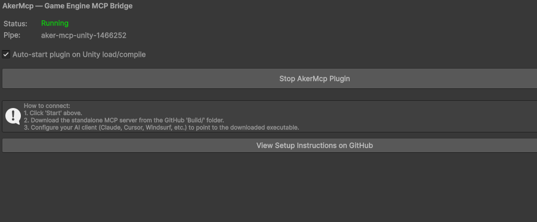

# Installing and connecting AkerMCP

The short version is in the [README](../README.md#quick-start-recommended). This page has every step, per engine and per AI client.

Two steps: **(1)** install the adapter for your engine, Unity, Godot or Stride (they are peers; pick the one you use), then **(2)** [connect your AI client](#connecting-an-ai-client) to the AkerMCP server, which is identical for all of them and finds whichever engine is running.

> `setup`, `doctor`, the **Connect** button in Unity and the npm and NuGet launchers arrive with **v1.7.0**. With v1.6.0, download the server and configure the client [by hand](#by-hand).

## Installing the plugin

### 1a. Unity Setup

> You do not need to install the .NET SDK or compile any code for Unity.

1. Go to the [latest GitHub Release](https://github.com/lorenzo-cambiaghi/AkerMCP/releases/latest) and download `AkerMCP.unitypackage`.
2. Open your Unity project and double-click the package to import it.
   *(This package already contains all necessary C# scripts, dependencies, and Roslyn compilers).*
3. **(Optional)** In the bundled sample project (`samples/unity`), the menu **AkerMcp → Setup Test Scene** creates a ready-to-test scene. The package itself adds no menu to your project besides **Window → AkerMcp**.
4. Open **Window → AkerMcp**. The plugin starts by itself with the editor and after every recompile (status **Running**; **Start** if you turned that off under **Advanced**). Then click **Connect** next to your AI client: see [From the Unity editor](#from-the-unity-editor-no-terminal).
   *(The server finds the plugin through a lock file and keeps retrying in the background, so either can start first).*

   

### 1b. Godot Setup

AkerMCP ships a **Godot 4.x (.NET/C#) adapter** with the **same full toolset** as Unity. Because a Godot project is a real `.csproj`, there are no DLLs to copy: references and the Roslyn engine come via NuGet/ProjectReference.

1. Download `AkerMcp.Godot-addon.zip` from the [latest Release](https://github.com/lorenzo-cambiaghi/AkerMCP/releases/latest) and extract it into your project's `addons/` folder, so you get `addons/aker_mcp/`. The zip carries the AkerMcp core it builds against as source, in `addons/aker_mcp/core/Shared` and `addons/aker_mcp/core/Client` (a `.gdignore` keeps the editor from treating it as project scripts).
2. Add the AkerMcp core to your game's `.csproj` (or use the included `samples/godot` project directly; run `setup-samples` first to link the addon):
   ```xml
   <PropertyGroup>
     <!-- Required for editor plugins. -->
     <EnableDynamicLoading>true</EnableDynamicLoading>
   </PropertyGroup>
   <!-- Editor only: Debug is the configuration the Godot editor builds, so exported games ship without AkerMcp or Roslyn. -->
   <ItemGroup Condition="'$(Configuration)' == 'Debug'">
     <ProjectReference Include="addons/aker_mcp/core/Shared/AkerMcp.Shared.csproj" />
     <ProjectReference Include="addons/aker_mcp/core/Client/AkerMcp.Client.csproj" />
     <PackageReference Include="Microsoft.CodeAnalysis.CSharp" Version="4.8.0" />
   </ItemGroup>
   <ItemGroup>
     <!-- The core builds as its own two projects, never as part of your game assembly. -->
     <Compile Remove="addons/aker_mcp/core/**" />
   </ItemGroup>
   ```
   If you copied this repo's `plugins/godot` folder into your project as `addons/aker_mcp` instead of using the zip, point the two `ProjectReference`s at the repo's `Shared/AkerMcp.Shared.csproj` and `Client/AkerMcp.Client.csproj`; the `Compile Remove` line is then not needed.
3. Build the C# solution once (**Project → Tools → C#: Create/Build**), then enable the plugin under **Project → Project Settings → Plugins → AkerMcp**.

Every addon file is wrapped in `#if TOOLS`, which Godot defines only for the editor's Debug build, so exporting the game (ExportDebug / ExportRelease) compiles none of it.

The plugin auto-starts with the editor and pumps requests on the main thread every frame. Scene paths follow the edited scene root (e.g. `/TestScene/Box`), property paths are case-insensitive (`position.x` resolves to `Position.X`), and screenshots capture the editor's 2D or 3D viewport, whichever the edited scene uses (`view: "2d"`/`"3d"` picks one explicitly; while the game runs in its own window, `view: "game"` falls back to OS-level window capture). `create`, `delete` and the nodes placed by `create_sprite`/`create_sound` are single steps in the editor's Undo history and mark the scene unsaved; `set_property` is not undoable on Godot yet. The standalone MCP server discovers the Godot plugin automatically, with no server changes.

### 1c. Stride Setup

AkerMCP ships a **Stride (Game Studio) adapter** with the **same full toolset**, including undoable edits via Stride's Quantum graph, `execute` (Roslyn), real Scene-view screenshots (editor back-buffer, with gizmos), and the platform/build tools (`dotnet build` per executable project).

> Stride support runs as a Game Studio editor plugin. Game Studio has no third-party plugin discovery, so AkerMcp registers itself with one tiny bootstrap. Pick the path that matches how you got Stride.

#### Option A (recommended): Stride installed from the Launcher, official binaries, no Stride rebuild

A per-launch wrapper injects the plugin **only into the Game Studio process it starts**, via the .NET runtime's `DOTNET_STARTUP_HOOKS`. The variable is never written to your user/machine environment, so it cannot affect any other .NET app; if the plugin DLL is ever missing, the wrapper just launches Game Studio without AkerMcp.

```powershell
# one-time, from the repo root
.\install-stride-wrapper.ps1 -GameStudioPath "C:\path\to\Stride.GameStudio.exe"
# (omit -GameStudioPath to auto-detect a Launcher install)
```

This builds the adapter against your installed Game Studio, drops it into `<GameStudio>/AkerMcpPlugins`, and creates a **"Stride Game Studio (AkerMCP)"** shortcut (Desktop + Start Menu). Launch Stride from that shortcut and **open a project + scene**; the pipe server starts automatically. Your official Stride shortcut keeps launching Game Studio untouched. Remove everything with `.\install-stride-wrapper.ps1 -Uninstall` (the shortcuts go first, so they are removed even if Game Studio has since moved).

The Launcher installs Game Studio as a NuGet package (`~/.nuget/packages/stride.gamestudio/<version>/lib/<tfm>/`), which is where auto-detect looks first, newest version first. In that layout the Stride assemblies sit in their own packages rather than next to the exe, so the script gathers the ones the adapter references into `plugins/stride/obj/StrideRefs/`; if one is missing, start Game Studio once from the Launcher so it restores its packages. The adapter and the wrapper are built for the .NET that Game Studio runs on, read from its `Stride.GameStudio.runtimeconfig.json` (4.2 is .NET 8, 4.3+ is .NET 10). Only Game Studio itself loads the plugin: the processes it starts (`dotnet build`, MSBuild, the game) inherit the startup hook but leave it at once, and they load a copy under `%TEMP%\AkerMcp\stride-hook`, so they never lock the installed files.

#### Option B: you build Stride Game Studio from source

The adapter loads in-process via a drop-in loader patched into Game Studio itself (no wrapper needed).

1. Build **Stride Game Studio** from source (the adapter references its editor assemblies). See the [Stride build docs](https://github.com/stride3d/stride).
2. Add a drop-in plugin loader to `Stride.GameStudio/Program.cs` (right after the built-in plugins are registered) so Game Studio loads any adapter placed in an `AkerMcpPlugins` folder next to `Stride.GameStudio.exe`:
   ```csharp
   var akerPluginsDir = System.IO.Path.Combine(System.AppContext.BaseDirectory, "AkerMcpPlugins");
   if (System.IO.Directory.Exists(akerPluginsDir))
       foreach (var dll in System.IO.Directory.GetFiles(akerPluginsDir, "*.dll"))
           try { foreach (var t in System.Reflection.Assembly.LoadFrom(dll).GetTypes())
                     if (!t.IsAbstract && typeof(AssetsPlugin).IsAssignableFrom(t) && t.GetConstructor(System.Type.EmptyTypes) != null)
                         AssetsPlugin.RegisterPlugin(t); }
           catch { /* skip incompatible DLLs */ }
   ```
3. Build + deploy the adapter into Game Studio with `setup-stride.ps1 -StrideBin <your Game Studio build output>` (required: there is no default path), then launch Game Studio and **open a project + scene**; the plugin starts the pipe server when a project opens.

Either way, the standalone MCP server then discovers the Stride engine automatically, the same as Unity and Godot.

### 2. MCP Server Setup

**Connect** in Unity and `setup` in a terminal install the server for you; this step is for configuring a client by hand.

1. Go to the [latest GitHub Release](https://github.com/lorenzo-cambiaghi/AkerMCP/releases/latest).
2. Download the standalone server for your OS (`AkerMcp.Server-win-x64.zip`, `-osx-x64.zip`, or `-linux-x64.zip`).
3. Extract the archive anywhere on your computer. From v1.7.0, `AkerMcp.Server setup` run from that folder copies the server to the per-user folder below and connects your AI clients, so the download can then be deleted.

---

## Connecting an AI Client

The AI client starts the server; it only has to know where the server is. Three ways to tell it, from no typing at all to full control. Whichever you pick, the entry is called `game-engine`.

### From the Unity editor (no terminal)

**Window → AkerMcp** lists the AI clients installed on this computer: Claude Code, Claude Desktop, Cursor, Windsurf, Google Antigravity and VS Code (**Show all clients** lists the others too). **Connect** downloads the AkerMCP server of the plugin's own version from its GitHub release (about 30 MB, once per version) into a folder of your user:

| OS | Folder |
|---|---|
| Windows | `%LOCALAPPDATA%\AkerMcp\server` |
| macOS | `~/Library/Application Support/AkerMcp/server` |
| Linux | `$XDG_DATA_HOME/AkerMcp/server`, by default `~/.local/share/AkerMcp/server` |

and writes the client's `game-engine` entry with the full path to it. Nothing else has to be installed: no Node.js, no .NET. Before the file is written it is copied next to itself as `<file>.aker-backup`; the other servers and settings in it stay as they were. Comments and trailing commas cannot survive a JSON rewrite, and when the file had some, the window says so and points at the backup. Restart the client, or start a new Claude Code session, to pick the entry up.

The button next to each client says what it would do:

| Button | When |
|---|---|
| **Connect** | the client has no `game-engine` entry |
| **Disconnect** | it starts this plugin's server; removes the entry and nothing else |
| **Update** | it starts the server of another plugin version, typically right after you updated the plugin |
| **Apply** | it starts this server with another tool profile than the one chosen under **Advanced** |
| **Repair** | its entry cannot start: the file it points to is gone, or a bare `npx` on Windows |
| **Replace** | it starts a command of your own; it is left alone unless you click |

The tool profile written by these buttons (`standard` by default, `core`, `full`) is under **Advanced**, with the switch that turns `execute` off for this editor. The server folder is shown there too.

Claude Code also keeps servers per project (its *local* scope, in `~/.claude.json` under `projects`). Inside such a project that entry wins over the one the window writes; the window shows them in the tooltip of the client's status.

### From a terminal: `setup` and `doctor`

The server has two commands for people, which print and exit without starting MCP:

```bash
AkerMcp.Server setup          # from the unpacked release zip: installs itself, connects every AI client found
npx -y aker-mcp@latest setup  # the npm launcher (Node 18+): entries that follow new releases by themselves
aker-mcp setup                # the .NET global tool: dotnet tool install -g AkerMcp.Server

AkerMcp.Server doctor         # (or npx -y aker-mcp@latest doctor, aker-mcp doctor)
```

`doctor` lists each AI client with what its entry starts (and whether it can: a file that is gone, `npx` missing from `PATH`), the editors running with the AkerMcp plugin and their protocol version, and the next thing to do. It exits with 1 when something needs fixing.

`setup` writes what matches how it was started: the binary copied to the per-user folder, `npx -y aker-mcp@latest`, `aker-mcp`, or, from a build of this repository, `dotnet run --project <checkout>/Server`. On Windows the npx entry is `cmd /c npx -y aker-mcp@latest`: npx is a `.cmd` script there, and a client that starts its server without a shell (Claude Code, Claude Desktop) cannot start a bare `npx`. The same backup and the same rules as the Unity window apply, since both use one implementation (`Shared/Setup`).

| Option | |
|---|---|
| `--client <id\|all>` | `claude-code`, `claude-desktop`, `cursor`, `windsurf`, `antigravity`, `vscode`, or `all`. Default: the clients installed here |
| `--profile <core\|standard\|full>` | the tool profile the client starts the server with |
| `--launcher <installed\|npx\|dotnet-tool\|source>` | what the entry runs, instead of the default above |
| `--dry-run` | print what would change, write nothing |
| `--uninstall` | remove the `game-engine` entry, leave the rest |

The npm launcher downloads the server of its own version into the same per-user folder the Unity window uses. On the day a release lands, an AI client starting it does not wait for the download: it starts the newest server already there and fetches the new one in the background for the next start. `npx -y aker-mcp@latest update` fetches it right away. `AKER_MCP_HOME` moves the folder; `AKER_MCP_BINARY` makes the launcher run a binary of your own.

### By hand

Point your AI client to the standalone executable you extracted in Step 2, or to the one in the per-user folder above.

#### Claude Code (CLI)

```bash
claude mcp add game-engine -- /absolute/path/to/extracted/AkerMcp.Server
# or, with Node 18+ (on Windows: claude mcp add game-engine -- cmd /c npx -y aker-mcp@latest)
claude mcp add game-engine -- npx -y aker-mcp@latest
```

`claude mcp add` writes the entry for the current project (Claude Code's *local* scope); add `--scope user` for every project, which is what `setup` and the Unity window write.

#### Claude Desktop / Cursor / Windsurf

Open the MCP settings (or `claude_desktop_config.json`) and add the server:

```json
{
  "mcpServers": {
    "game-engine": {
      "command": "/absolute/path/to/extracted/AkerMcp.Server",
      "args": []
    }
  }
}
```

> **Windows users:** Replace the command path with the full Windows path to the `.exe`, for example `"C:\\Tools\\AkerMcp.Server\\AkerMcp.Server.exe"`. Remember to use double backslashes in JSON!

#### Google Antigravity

Antigravity reads `mcp_config.json` from its user-data directory (`~/.gemini/antigravity/` or `%USERPROFILE%\.gemini\antigravity\`). Add:

```json
{
  "mcpServers": {
    "game-engine": {
      "command": "C:/Tools/AkerMcp.Server/AkerMcp.Server.exe",
      "args": [],
      "type": "stdio"
    }
  }
}
```

#### VS Code + Copilot

Add to your `.vscode/settings.json` or use the **MCP: Add Server** command:

```json
{
  "mcp": {
    "servers": {
      "game-engine": {
        "command": "C:\\Tools\\AkerMcp.Server\\AkerMcp.Server.exe",
        "args": []
      }
    }
  }
}
```

The user-level `mcp.json` (**MCP: Open User Configuration**; it is what `setup` writes) takes the same entry under a top-level `"servers"` key, with `"type": "stdio"`.

#### Alternative: Running from Source (For Developers)

If you cloned the repository or prefer running via the .NET SDK instead of using the standalone binaries, use `dotnet run`. This is often necessary if you are actively modifying the MCP server code.

**CLI command:**
```bash
claude mcp add game-engine -- dotnet run --project /absolute/path/to/AkerMCP/Server -c Release --verbosity quiet --nologo
```

**JSON Configuration (for Claude Code config, Cursor, Antigravity, etc):**
```json
{
  "mcpServers": {
    "game-engine": {
      "type": "stdio",
      "command": "dotnet",
      "args": [
        "run",
        "--project",
        "C:/absolute/path/to/AkerMCP/Server",
        "-c",
        "Release",
        "--verbosity",
        "quiet",
        "--nologo"
      ]
    }
  }
}
```

---

## Updating

- **Unity:** **Window → AkerMcp → Check for updates** asks GitHub for the latest release (only when you click). **Update to v…** downloads that release's `AkerMCP.unitypackage` and imports it over the installed one; Unity lists what it replaces before you confirm. Then click **Update** next to each AI client, which moves it to the server of the new version; the Console says which clients still start the old one. A plugin installed through the Package Manager is updated from there.
- **Godot / Stride:** download the new `AkerMcp.Godot-addon.zip` (replace `addons/aker_mcp/`) or `AkerMcp.Stride-source.zip` (run `install-stride-wrapper.ps1` again), then `AkerMcp.Server setup` from the new server zip.
- **npx entries** follow new releases by themselves (see above); **the global tool** with `dotnet tool update -g AkerMcp.Server`.

Each server version keeps its own folder (about 70 MB) under the per-user folder; one that no client starts any more can be deleted.
